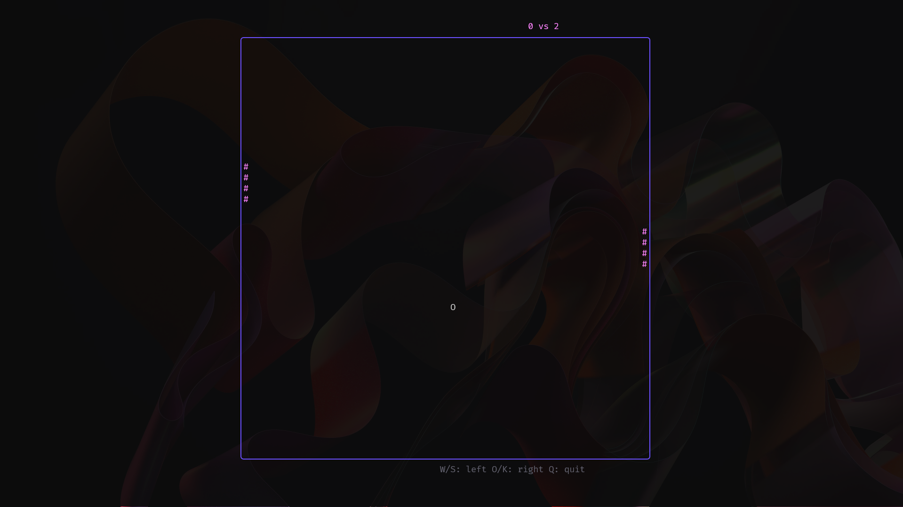

# Pong-tea(Bubbletea)

We are probing an interesting library that we found in the internet :)

## Installation:

```bash
git clone https://Yahm3/pong-tea.git
cd pong-tea
```
> install dependencies

```bash
go mod tidy
```

> run the game

```bash
go run main.go
```
## Screenshot:


## Library
[Check it out](https://github.com/charmbracelet/bubbletea/)
